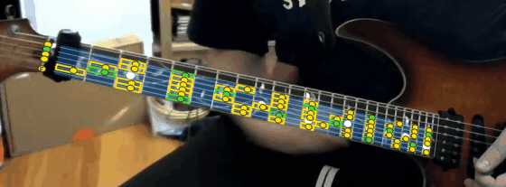

# Guitar Real-Time Overlay

Real-time AR overlay of scales/notes on a guitar fretboard from a close-up camera (home-office practice setup).

Approach: a custom-trained, fast fretboard keypoint model produces anchor points (nut / fret-wire × outer strings), which are smoothed over time and used by a renderer to draw the selected scale onto the neck in perspective.

- Plan: [docs/PLAN.md](docs/PLAN.md)
- Raw video data lives outside git (Google Drive + local `data/`, gitignored).

## Quickstart (M0/M1)

```sh
uv sync                                        # Python >= 3.10, numpy + opencv-python
uv run pytest                                  # theory, homography round-trip, index shift, mirror toggle, schema
uv run python scripts/hand_anchors.py --debug  # rebuild samples/anchors/*.json from the hand clicks
uv run python scripts/render_demo.py --resnap  # stills + 3 s LK-tracked demo (needs data/raw/*.mp4)
uv run python scripts/review_sheet.py samples/anchors --batch batch-000-hand  # review images -> review/<batch>/

# Auto-annotation (classical CV + a few AI calls; AI_GATEWAY_API_KEY in env or .env, optional)
uv sync --extra ai                             # optional: openai client (falls back to plain HTTP without it)
uv run python scripts/eval_auto.py             # vs GT in samples/anchors (+ samples/anchors_extra); --no-ai
uv run python scripts/auto_annotate.py frames --video data/raw/2026-09-06_09-00-01.mp4 --times 30,90 --mirrored \
    --out labels/auto/my-batch                 # or --images 'data/scraped/frames/*.jpg'; `clip --t0 --t1` for video
uv run python scripts/review_sheet.py labels/auto/my-batch --batch my-batch
```

(`make test|lint|anchors|demo|review` wrap the same commands.)

Layout:

- `src/gro/theory.py`: notes, tunings, scales and modes, key+scale → `(string, fret)` for frets 0–24.
- `src/gro/anchors.py`: `fretboard-kpts/v1` label schema (PLAN §3.1): load, save, validate, mirror.
- `src/gro/geometry.py`: robust fit (RANSAC + Huber refinement) of the canonical fretboard → image homography, with
  taper, every fret/string line, index-shift search, and the `M·H` mirror composition.
- `src/gro/render.py`: "reference"-style overlay (blue cells, strings, inlay dots, scale notes) and the
  left-handed/mirrored-camera helpers.
- `src/gro/snap.py`: annotation assist that snaps clicks to fret-wire ridges and fits edges from wire ends.
- `src/gro/review.py`: annotation review images: contact sheets, full-res frames with anchors + fitted grid, zoomed
  neck strips, fit stats (PLAN D8).
- `src/gro/auto/`: auto-annotation. `detect.py` (LSD ridge candidates -> RANSAC neck axis -> strip rectified along
  the wires' vanishing point -> 1D projective 12th-root-of-2 grid fit -> snap + edge fit -> anchors), `numbering.py`
  (labelled strip -> AI picks W1's fret number via nut / inlays / last fret; relative fallback), `pipeline.py`
  (frame -> label incl. D12 flags), `temporal.py` (keyframes + KLT propagation + re-snap, jump flags), `ai.py`
  (Vercel AI Gateway client, disk cache in `.cache/ai/`, cost ledger).
- `scripts/`: `zoom.py` (grid-labelled crops for annotating), `hand_anchors.py`, `render_demo.py`, `review_sheet.py`,
  `auto_annotate.py`, `eval_auto.py`.
- `review/<batch>/`: review images for each annotation batch. Every batch gets these, and Chase reviews them (D8).
- `samples/frames` (inputs), `samples/anchors` (labels), `samples/out` (renders; `demo.mp4` is gitignored).


